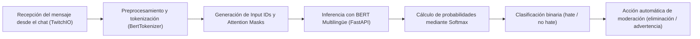

# Sistema de moderación automática de contenido basado en PLN para entornos que implementan chats en tiempo real

[](paper/Sistema%20de%20moderaci%C3%B3n%20autom%C3%A1tica%20de%20contenido.pdf)
[](https://www.python.org/)
[](https://pytorch.org/)
[](https://huggingface.co/)
[](https://fastapi.tiangolo.com/)

> **Repositorio oficial del artículo científico publicado en la revista del Centro de Investigación en Computación (CIC) del Instituto Politécnico Nacional (IPN) (*Research in Computing Science*).**
>
> 📄 **[Leer el artículo completo (PDF)](paper/Sistema%20de%20moderaci%C3%B3n%20autom%C3%A1tica%20de%20contenido.pdf)**

---

## Información de la Publicación y Créditos

- **Título del Paper:** *Sistema de moderación automática de contenido basado en PLN para entornos que implementan chats en tiempo real*
- **Autor del Artículo Científico:** [Jonathan Fernández Córdova](https://github.com/fercorfdzc) ([ORCID: 0009-0007-5609-2556](https://orcid.org/0009-0007-5609-2556))
- **Afiliación:** Departamento de Sistemas y Computación — TecNM, Instituto Tecnológico de Veracruz, Veracruz, Ver., México (`L25020480@veracruz.tecnm.mx`)
- **Publicado en:** Revista del Centro de Investigación en Computación (CIC), Instituto Politécnico Nacional (IPN) (*Research in Computing Science*)
- **Colaboradores en el Código del Proyecto:** [Renata Carolina Castro Olmos](https://github.com/RenataCastro19), [Brayan Emanuel Vázquez Peña](https://github.com/Brayan1224) y [Adriana de los Ángeles Toto Chapol](https://github.com/AdrianaTc26) *(colaboradores en el desarrollo del software; no coautores del artículo publicado)*
- **Palabras clave:** Procesamiento del Lenguaje Natural · Clasificación de texto · Redes neuronales · Detección de discurso de odio · Moderación de chats

---

## Resumen (Abstract)

Este trabajo presenta el diseño, implementación y evaluación de un **sistema de moderación automática de contenido basado en técnicas de Procesamiento de Lenguaje Natural (PLN)** para entornos de chat en tiempo real. El sistema tiene como objetivo detectar y clasificar mensajes generados por los usuarios en una formulación binaria: **discurso de odio (`hate`)** y **contenido no dañino (`no hate`)**, reduciendo la ambigüedad semántica presente en esquemas multiclase y mejorando la seguridad de las interacciones digitales.

El modelo fue entrenado mediante un ajuste fino (*fine-tuning*) completo de **`bert-base-multilingual-cased`** utilizando múltiples *datasets* públicos en español e inglés (~56,000 instancias), logrando un enfoque bilingüe con alta capacidad de generalización. Además, el modelo de inferencia se desacopla mediante una arquitectura REST en **FastAPI** y se integra con un bot asíncrono en **TwitchIO** capaz de analizar mensajes en vivo y aplicar acciones correctivas automáticas (eliminación de mensajes y advertencias) con baja latencia.

---

## Contribuciones Principales del Paper

1. **Enfoque Bilingüe Unificado (Español / Inglés):** Construcción de un corpus balanceado de ~56,000 instancias integrando cinco fuentes públicas de discurso de odio y sentimiento para reducir falsos positivos en texto cotidiano no ofensivo.
2. **Optimización de *Fine-Tuning* en Transformers:** Entrenamiento completo de `bert-base-multilingual-cased` estabilizado con *Dropout* ($p = 0.4$), *Weight Decay*, *Gradient Clipping*, *Automatic Mixed Precision (AMP)* y *Early Stopping*.
3. **Superioridad Experimental Comprobada:** Desempeño global de **92.87% en Accuracy y Macro F1-score**, superando consistentemente a clasificadores clásicos (Naive Bayes, Random Forest, Regresión Logística y SVM) y mostrando estabilidad estadística de **0.93** a través de múltiples inicializaciones aleatorias.
4. **Arquitectura de Moderación en Tiempo Real:** Integración práctica extremo a extremo entre el servicio de inferencia (FastAPI) y el protocolo IRC de transmisión en vivo (TwitchIO).

---

## Materiales y Métodos

### 1. Construcción del Dataset Bilingüe

El corpus final (~56,000 instancias: **72% inglés** y **28% español**) se conformó integrando y adaptando a clasificación binaria (`0: no hate`, `1: hate`) cinco conjuntos de datos públicos:

| Dataset | Idioma | Tipo de Contenido |
| :--- | :---: | :--- |
| **Spanish Hate Speech Superset** | Español | Hate Speech |
| **TASS 2019** | Español | Sentimiento adaptado (`hate` / `no hate`) |
| **HatEval (SemEval-2019 Task 5)** | Español / Inglés | Hate Speech |
| **Hate Speech and Offensive Language** | Inglés | Hate / Offensive |
| **Stanford Sentiment Treebank (SST-2)** | Inglés | Sentimiento (contexto no ofensivo) |

La partición del conjunto de datos se realizó de manera **estratificada** para preservar la proporción de ambas clases:
- **Entrenamiento:** 70%
- **Validación:** 15%
- **Prueba:** 15%

### 2. Arquitectura del Modelo y Configuración de Entrenamiento

Se empleó la arquitectura Transformer encoder **`bert-base-multilingual-cased`** (12 capas, 12 cabezas de atención, dimensión oculta $d = 768$, vocabulario de ~119,547 tokens y >90M de parámetros), clasificando sobre la representación contextual del token especial `[CLS]`:

$$\hat{y} = \text{softmax}(W h_{[\text{CLS}]} + b)$$

| Parámetro / Técnica | Configuración en el Paper |
| :--- | :--- |
| **Tokenizador** | `BertTokenizer` (truncamiento y *padding* a `max_length = 150`) |
| **Estrategia de ajuste** | *Fine-tuning* completo (sin congelamiento de capas) |
| **Regularización en salida** | Capa `Dropout` con probabilidad $p = 0.4$ |
| **Tamaño de lote (*Batch Size*)** | 32 muestras (máximo 7 épocas) |
| **Optimizador** | `AdamW` ($\text{lr} = 2 \times 10^{-5}$, *weight decay* $L_2 = 0.01$) |
| **Planificador (*Scheduler*)** | *Linear learning rate decay* sin fase de *warmup* |
| **Estabilidad numérica** | *Gradient Clipping* ($\|\nabla\theta\|_2 \le 1.0$) + *Automatic Mixed Precision* (`torch.amp`) |
| **Criterio de parada** | *Early Stopping* sobre pérdida de validación ($\text{patience} = 2$) |
| **Función de pérdida** | `CrossEntropyLoss` |

### 3. Sistema de Implementación en Tiempo Real

El flujo operacional diseñado en el artículo desacopla la inferencia neuronal del cliente de chat:



---

## Resultados Experimentales

### Comparación frente a Modelos Clásicos de Aprendizaje Automático

En la evaluación sobre el conjunto de prueba estratificado, el modelo basado en *Transformers* superó a todos los algoritmos tradicionales evaluados en el artículo:

| Modelo | Accuracy | F1-score |
| :--- | :---: | :---: |
| Naive Bayes | 0.8514 | 0.8514 |
| Random Forest | 0.8923 | 0.8923 |
| Logistic Regression | 0.9063 | 0.9063 |
| SVM | 0.9128 | 0.9128 |
| **BERT (`bert-base-multilingual-cased`)** | **0.9287** | **0.9287** |

### Matriz de Confusión (Conjunto de Prueba)

El modelo demostró un equilibrio sólido entre sensibilidad y especificidad sobre las 8,410 instancias del conjunto de prueba:

| Real \ Predicción | No Odio (`0`) | Odio (`1`) |
| :--- | :---: | :---: |
| **No Odio (`0`)** | **3,922** (VN) | 283 (FP) |
| **Odio (`1`)** | 332 (FN) | **3,873** (VP) |

### Estabilidad Estadística en Múltiples Ejecuciones

Se ejecutaron 5 entrenamientos independientes con distintas semillas aleatorias para verificar la robustez del proceso de optimización:

| Ejecución | Accuracy | Recall | F1-score |
| :---: | :---: | :---: | :---: |
| 1 | 0.93 | 0.93 | 0.93 |
| 2 | 0.92 | 0.92 | 0.92 |
| 3 | 0.92 | 0.92 | 0.92 |
| 4 | 0.93 | 0.93 | 0.93 |
| 5 | 0.93 | 0.93 | 0.93 |
| **Promedio** | **0.93** | **0.93** | **0.93** |

---

## Estructura del Repositorio

```text
├── api/                         # Servicio REST en FastAPI para inferencia en tiempo real
├── bot/                         # Bot asíncrono en TwitchIO para moderación de chats en vivo
├── data/                        # Scripts y conjuntos de datos procesados (ES / EN)
├── models/                      # Pesos y checkpoints del modelo BERT ajustado
├── notebooks/                   # Notebooks de experimentación, EDA y entrenamiento
├── paper/                       # Artículo científico publicado en la revista del CIC-IPN
│   └── Sistema de moderación automática de contenido.pdf
├── comparar_modelos.py          # Script de evaluación comparativa (NB, RF, LR, SVM vs. BERT)
├── comparacion_modelos_final.csv# Resultados tabulares de la comparativa experimental
├── requirements.txt             # Dependencias del entorno (Python 3.10+)
└── README.md
```

---

## Cómo Citar este Trabajo

Si utilizas este sistema, el código o los resultados experimentales en tu investigación, por favor cita el artículo publicado en la revista del **CIC-IPN**:

### Formato APA
> Fernández Córdova, J. (2026). Sistema de moderación automática de contenido basado en PLN para entornos que implementan chats en tiempo real. *Research in Computing Science (Revista del Centro de Investigación en Computación, Instituto Politécnico Nacional)*.

### BibTeX
```bibtex
@article{fernandez2026moderacion,
  title   = {Sistema de moderaci{\'o}n autom{\'a}tica de contenido basado en PLN para entornos que implementan chats en tiempo real},
  author  = {Fern{\'a}ndez C{\'o}rdova, Jonathan},
  journal = {Research in Computing Science - Centro de Investigaci{\'o}n en Computaci{\'o}n (CIC), Instituto Polit{\'e}cnico Nacional (IPN)},
  year    = {2026},
  note    = {Departamento de Sistemas y Computaci{\'o}n, TecNM - Instituto Tecnol{\'o}gico de Veracruz}
}
```

---

## Autores y Colaboradores

### Autor del Artículo Científico (Paper CIC-IPN) y Desarrollador Principal
- **[Jonathan Fernández Córdova](https://github.com/fercorfdzc)** — *Departamento de Sistemas y Computación, TecNM - Instituto Tecnológico de Veracruz* ([ORCID: 0009-0007-5609-2556](https://orcid.org/0009-0007-5609-2556))

### Colaboradores en el Desarrollo del Código
> Los siguientes integrantes colaboraron activamente en el desarrollo e implementación del código de este repositorio (la autoría e investigación del artículo científico publicado en el CIC-IPN corresponde exclusivamente a Jonathan Fernández Córdova):

- **[Renata Carolina Castro Olmos](https://github.com/RenataCastro19)** — *Colaboración en código*
- **[Brayan Emanuel Vázquez Peña](https://github.com/Brayan1224)** — *Colaboración en código*
- **[Adriana de los Ángeles Toto Chapol](https://github.com/AdrianaTc26)** — *Colaboración en código*
